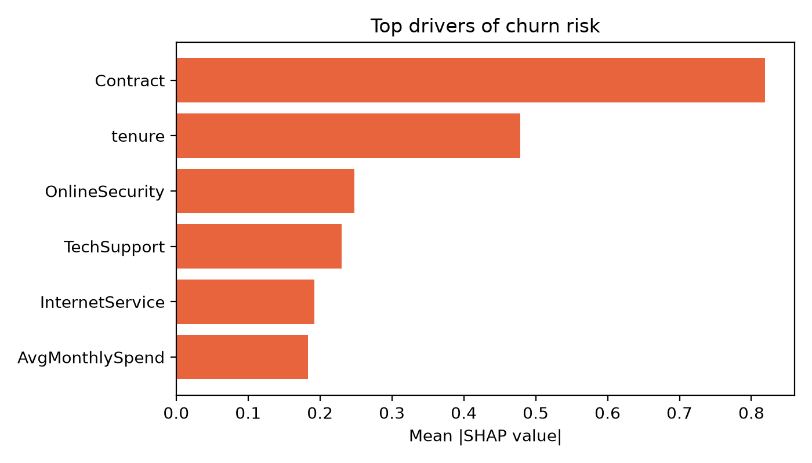
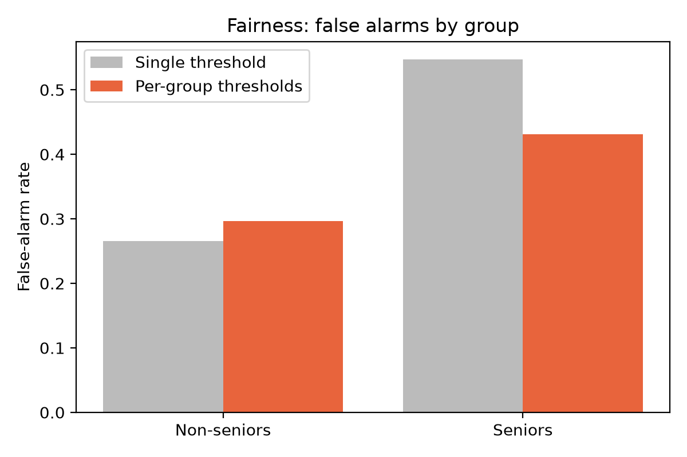
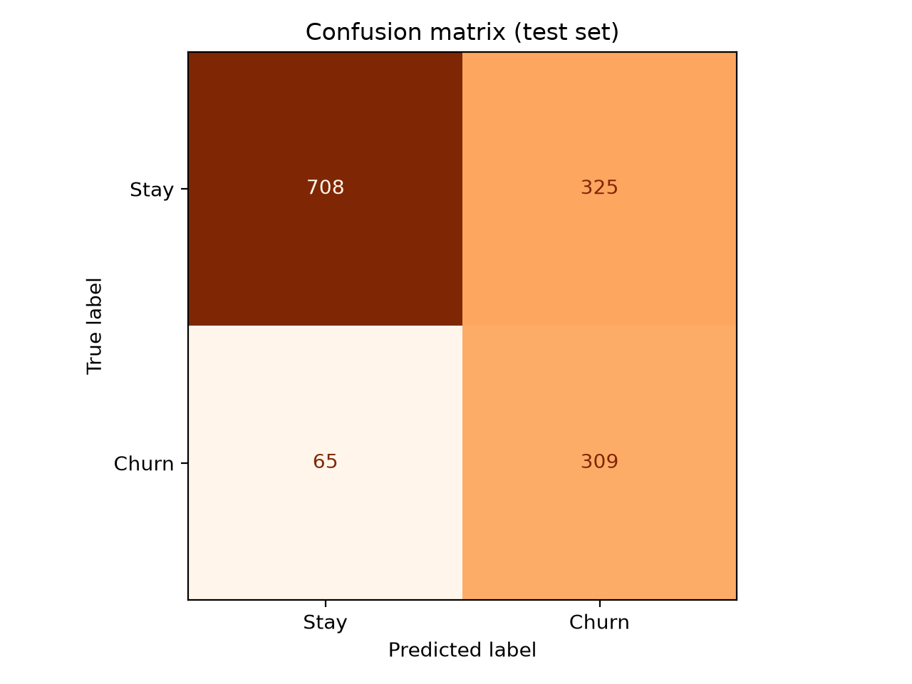
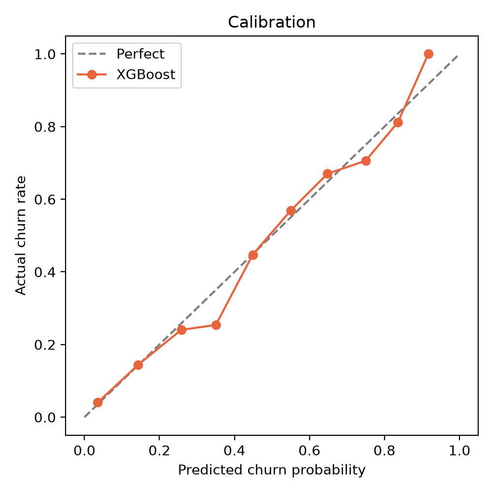

# Trustworthy Churn Predictor

A customer churn model that is not just accurate, but **fair across customer groups, explains every prediction, and is monitored for drift**.

Built on the IBM Telco Customer Churn dataset with XGBoost, Fairlearn and SHAP, and served through a Gradio app that shows a risk score with its top 3 reasons.

---

## Why

A churn score is a decision about a person. A black-box model that is accurate on average can still:
- give no reasons, so retention teams can't act on it,
- treat some customer groups worse than others,
- silently degrade as customer behaviour changes.

This project addresses all three: **fairness, explainability and reliability**.

## Results (test set, 1,407 customers)

| Metric | Value |
|---|---|
| ROC-AUC | **0.85** |
| Recall in top 30% riskiest | **0.70** |
| Precision / Recall (fair thresholds) | 0.487 / 0.826 |
| Brier score (calibration) | 0.135 |
| Equalized-odds gap, seniors vs non-seniors | **0.282 → 0.134** |

<p>
  
  
</p>
<p>
  
  
</p>

## Key findings

- **Contract type and tenure drive churn.** Month-to-month customers with short tenure are the highest risk.
- **Seniors were over-flagged.** With one shared threshold, senior citizens got false alarms at twice the rate of others (0.55 vs 0.27).
- **Per-group thresholds cut the fairness gap by more than half**, with almost no loss in precision or recall.
- **The trade-off is explicit:** fewer false alarms for seniors (0.55 → 0.43), but more senior churners missed (0.09 → 0.25). This is a policy choice, documented in the [model card](MODEL_CARD.md).
- Logistic regression performed about as well as XGBoost. Calibration added nothing, because XGBoost was already well calibrated.

## Pipeline

1. **Data:** 7,032 customers, 26.6% churn. Stratified 60/20/20 train/validation/test split.
2. **Features:** average monthly spend, number of services, log of total charges. `gender` and `SeniorCitizen` are **excluded from the model** and used only for fairness checks.
3. **Proxy check:** mutual information between each feature and `SeniorCitizen`.
4. **Models:** logistic regression, XGBoost, LightGBM.
5. **Fairness audit:** false-negative and false-positive rates by group (Fairlearn).
6. **Mitigation:** a separate threshold per group, each catching 80% of churners.
7. **Calibration:** isotonic calibration and Brier score.
8. **Explainability:** SHAP, globally (top drivers) and per customer (top 3 reasons).
9. **Drift:** Population Stability Index; a simulated 10% price rise gives PSI 1.16 (alert above 0.2).

## Run it

```bash
pip install pandas numpy scikit-learn xgboost lightgbm shap fairlearn gradio joblib matplotlib
python churn_model.py   # trains, prints results, saves the model and plots
python app.py           # opens the app at http://127.0.0.1:7860
```

The dataset downloads automatically from IBM's GitHub.

## Files

| File | What it is |
|---|---|
| `churn_model.py` | Full pipeline: data → model → fairness → SHAP → evaluation → drift → saved model and plots |
| `app.py` | Gradio app: risk score, decision and top 3 reasons |
| `MODEL_CARD.md` | Intended use, data, performance, fairness choices, limitations |

## Limitations

- One public dataset with no timestamps, so a time-based split wasn't possible.
- The senior group is small (~16%), so its fairness numbers are noisy and vary between runs.
- Using a protected attribute to choose thresholds may be legally restricted in some regions.

## Credits

Builds on [arshpreetw11/Churn-predictor](https://github.com/arshpreetw11/Churn-predictor). Dataset: IBM Telco Customer Churn.
